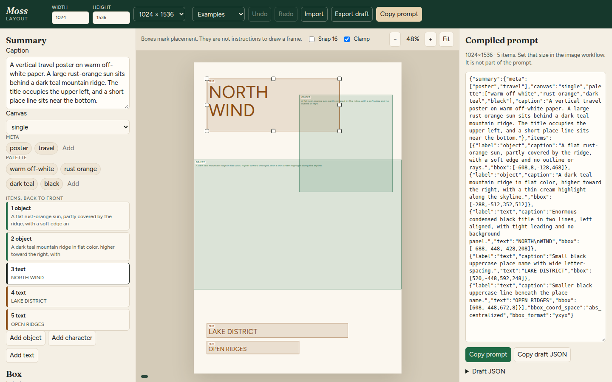

# moss-image-layout-editor

Visual layout editor for [MOSS-Image](https://github.com/OpenMOSS/MOSS-Image) draft prompts. Arrange text, objects, and characters on a canvas, then copy a prompt compiled the same way as the official `compile_prompt.py`.

The app is a static site. It does not call a generation API, a backend, or an analytics service.

## Screenshot



## How this relates to the official compiler

MOSS-Image layout prompts use a compact JSON form (`bbox_coord_space` `abs_centralized`, `bbox_format` `yxyx`). The official prompt-enhancer skill keeps an editable draft — top-left pixel boxes in `xyxy` order, plus `width` and `height` — and compiles it with:

[`skills/moss-image-prompt-enhancer/scripts/compile_prompt.py`](https://github.com/OpenMOSS/MOSS-Image/blob/a211e398a33cbf4dd7a1cc52aba0dfdbac3b0281/skills/moss-image-prompt-enhancer/scripts/compile_prompt.py)

`src/compile/compilePrompt.ts` is a TypeScript port of that script. It checks the same fields and converts boxes the same way: round each edge to 9 decimal places (half to even, on the exact binary64 value), floor the top and left, ceil the bottom and right, then subtract half the canvas with integer division. The compiled prompt is one line of JSON and does not include width or height. Use those dimensions in the image workflow separately.

`tests/compilePrompt.test.ts` ports [`test_compile_prompt.py`](https://github.com/OpenMOSS/MOSS-Image/blob/a211e398a33cbf4dd7a1cc52aba0dfdbac3b0281/skills/moss-image-prompt-enhancer/scripts/test_compile_prompt.py).

Verified against [OpenMOSS/MOSS-Image](https://github.com/OpenMOSS/MOSS-Image) commit [`a211e398a33cbf4dd7a1cc52aba0dfdbac3b0281`](https://github.com/OpenMOSS/MOSS-Image/commit/a211e398a33cbf4dd7a1cc52aba0dfdbac3b0281). In that tree, `compile_prompt.py` is blob `ff7aaa85fa1b0ae4e97bb1ca5b698093dfdd5aee` and `test_compile_prompt.py` is blob `fcf410b68c5faa1f4a2b6c4691656fc8a45b6203`, both unchanged since [`20f5592077916ec8d439bed7b34d18e45c20d657`](https://github.com/OpenMOSS/MOSS-Image/commit/20f5592077916ec8d439bed7b34d18e45c20d657).

The draft schema is documented in the skill's [layout reference](https://github.com/OpenMOSS/MOSS-Image/blob/a211e398a33cbf4dd7a1cc52aba0dfdbac3b0281/skills/moss-image-prompt-enhancer/references/layout.md):

- Boxes are `[x_min, y_min, x_max, y_max]` in pixels from the top-left.
- `width` and `height` are positive multiples of 16.
- `bbox_coord_space` is `abs` and `bbox_format` is `xyxy`.
- Each item has a `label` of `text`, `object`, or `character`, plus a `caption`.
- Text items include the literal `text`. Line breaks in that string are the intended line breaks.
- `summary` holds `caption` and, when useful, `meta`, `canvas` (`single`, `multi_panel`, or `collage`), and `palette`.

Changing the canvas size leaves boxes where they are. Export writes this draft. The side panel shows the compiled prompt. The editor keeps canvases up to 4096 pixels on a side; the compiler itself does not have that limit. Matching the canvas to a reference image scales boxes only when you choose Scale boxes.

## Examples

The app includes four drafts written for this editor: a poster, a menu, a comic page, and a book cover. They are layout JSON in the official draft format so you can start from a composition. They are not sample model outputs. None of them includes a reference image.

## Reference image

Load a local image as a layer under the boxes with the Reference button, or drop the file on the canvas. The image stays in the browser as an object URL. It is not uploaded, and the editor does not call a generation API.

Show, hide, and the opacity slider change only that overlay. Remove drops it. Use image size sets the canvas to the image’s pixel size, capped at 4096 on the longer side. If boxes already exist, confirm whether to keep their positions or scale them in proportion to the new canvas. Otherwise the image is fit inside the current canvas, preserving its aspect ratio.

The reference image is omitted from the exported draft and from the compiled prompt, so the prompt stays identical to the official compiler output.

One use is to overlay an image you generated with MOSS-Image, adjust the boxes and text against it, then export a new draft to regenerate.

## Run, test, build

Requires Node.js 22 or newer.

```bash
npm install
npm run dev          # http://localhost:5173
npm test
npm run build        # static site in dist/
npm run preview
```

Compile a draft from the command line, in the same role as the official script:

```bash
npx tsx src/cli.ts draft.json --output prompt.txt
```

`npm test` runs the ported compiler cases and checks that the built-in drafts compile.

## Static hosting

`npm run build` writes the site to `dist/` with relative asset URLs, so the folder works as a GitHub project site or as a directory of static files. [`.github/workflows/pages.yml`](.github/workflows/pages.yml) deploys `dist/` to GitHub Pages when `main` is pushed. In the repository settings, set Pages to deploy from GitHub Actions.

The same `dist/` folder can later be published as a Hugging Face static Space (`sdk: static` in the Space README). No Python server is required.

## License

Apache-2.0. See [LICENSE](LICENSE).

The compiler port is derived from the Apache-2.0 MOSS-Image prompt enhancer script.

Used in production at [MOSS-Image AI](https://mossimages.com).
